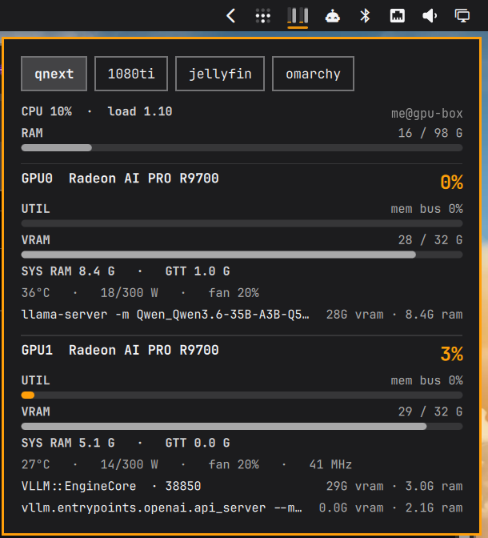

# GPU Fleet

An Omarchy bar widget for watching GPUs on this machine **and on other Linux
hosts on your network** (homelab servers, VMs with GPU passthrough, a training box).
Nothing is installed on those hosts. A small Python agent (standard library only) is sent
over SSH each time it starts.



## What it shows

- **Bar:** two thin meters per GPU (utilization | VRAM) for one host, the tab you
  last picked in the panel. The choice is saved and shared across monitors.
  A meter turns red at the hot temperature (85 °C by default). A small red dot means
  a host that is *not* shown is running hot or is offline. Hover for a one-line
  summary of every host.
- **Panel** (left-click, or `omarchy-shell io.github.meyert11.gpu-fleet toggle`): a tab
  per host (←/→ to switch) with host CPU, load and RAM, then a card per GPU:
  utilization, VRAM, RAM used by its processes, temperature, power/cap, fan and the
  processes using it.
- Middle-click re-reads the state file.

| GPU | Source | Notes |
|---|---|---|
| AMD (amdgpu) | kernel sysfs + `/proc/*/fdinfo` | No ROCm needed. Process lists show processes the SSH user can see (usually its own). |
| Intel (i915, xe) | kernel sysfs + `/proc/*/fdinfo` | Utilization is the busiest engine (render, video, …) from the DRM client counters. Integrated GPUs show the system memory their clients hold and the CPU package temperature (same die); power isn't readable without root. |
| NVIDIA | `nvidia-smi` | Needs the NVIDIA driver's `nvidia-smi` on the host. |

## Requirements

- Omarchy with the Quickshell-based Omarchy shell.
- `python3` on this machine and on every remote host.
- Remote hosts: SSH that logs in **without a prompt** (key in `ssh-agent` or a key
  file without a passphrase, `BatchMode=yes`). The host key is accepted on first
  connection (`StrictHostKeyChecking=accept-new`) and then pinned in `~/.ssh/known_hosts`.
- Linux GPU hosts. The agent reads `/sys` and `/proc` and needs no root.

## Install

```bash
omarchy plugin add https://github.com/meyert11/omarchy-gpu-fleet --enable
```

With no configuration it shows this machine's GPUs only.

After `omarchy plugin update`, run `omarchy restart shell`. The shell can keep the
previous version's widget loaded until it restarts.

## Add hosts

Create `~/.config/omarchy/gpu-fleet.json` (see `gpu-fleet.example.json`):

```json
{
  "interval": 2,
  "hosts": [
    {"name": "desktop", "ssh": "local"},
    {"name": "trainer", "ssh": "me@10.0.0.5"},
    {"name": "llm-box", "ssh": "llm-box"}
  ]
}
```

- `name` is the tab label (32 characters max).
- `ssh` is `user@host`, an alias from `~/.ssh/config` (use that for ports, jump hosts
  and keys), or `local` for this machine.
- `interval` is seconds between samples (0.5–30, default 2).

If the file can't be read, or a host entry is invalid or uses a name that's already
taken, the panel shows a red **Config:** line saying what was skipped. A file that
can't be read falls back to this machine only.

The file lives outside the plugin folder, so `omarchy plugin update` never touches it.
After editing it, run `omarchy restart shell` (the collector reads it at start).

Test a host without the shell:

```bash
cd ~/.config/omarchy/plugins/io.github.meyert11.gpu-fleet
python3 fleetmon.py --once            # one merged snapshot as JSON
ssh me@host python3 - 1 < agent.py    # raw agent stream from one host
```

## Settings

In the bar widget settings: **Hot temperature (°C)**. That's the junction temperature
on AMD and the core temperature on NVIDIA.

## How it works

`Service.qml` starts `fleetmon.py`, which keeps one long-lived SSH session per host
running `python3 -` with `agent.py` on stdin. Each agent prints one JSON line per
interval. The collector merges them into `$XDG_RUNTIME_DIR/gpu-fleet/state.json`, which
the shell reads. An unreachable host shows as offline with the SSH error and is retried
with backoff. Stopping the shell stops every SSH session.

The agent only reads files and runs `nvidia-smi` / `lspci`; it writes nothing on the host.

## Remove

```bash
omarchy plugin remove io.github.meyert11.gpu-fleet
rm -f ~/.config/omarchy/gpu-fleet.json   # optional: your host list
```

## Known limits

- Changes to the host list need `omarchy restart shell`.
- AMD per-process memory comes from DRM `fdinfo`; other users' processes are only
  visible if the SSH user can read their `/proc` entries.
- Intel utilization counts the GPU clients the SSH user can read (on a desktop, the
  user's own session). Tested on integrated i915 (UHD 620); the `xe` driver and Arc
  discrete cards are handled but untested.
- Very new AMD cards may show as "Device 7551"-style names until the host's
  `pci.ids` knows them. A few are named in `agent.py` (`KNOWN_AMD`).

## License

MIT. See [LICENSE](LICENSE).
